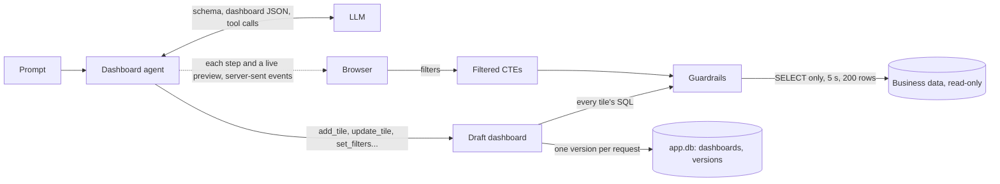
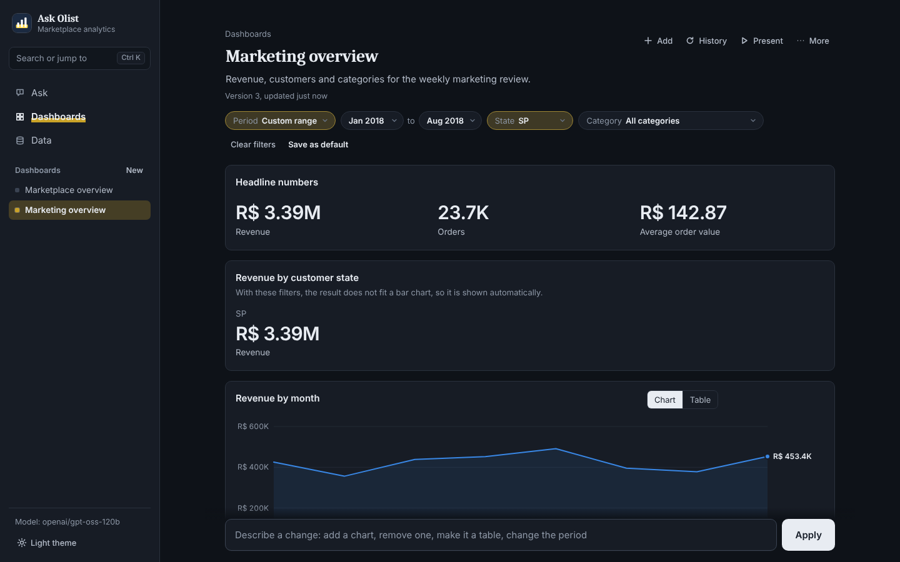
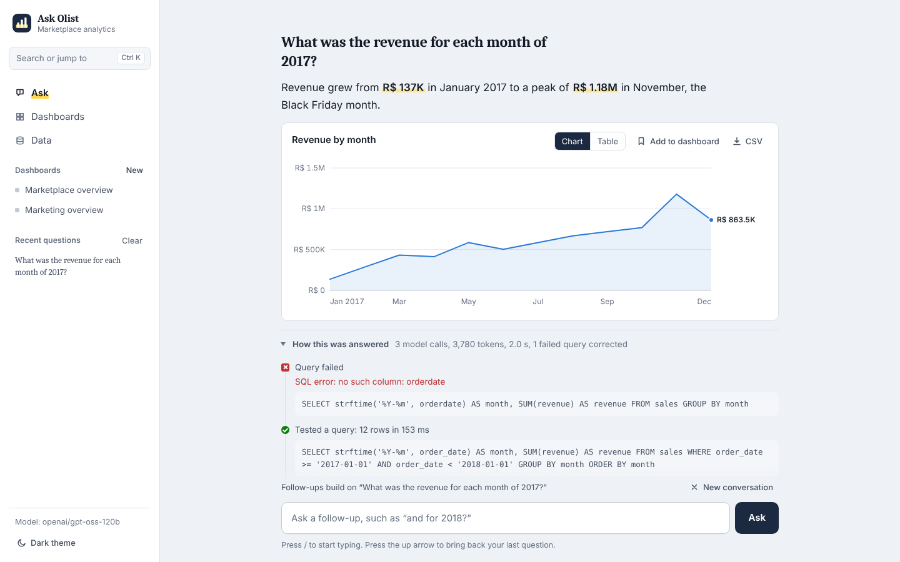
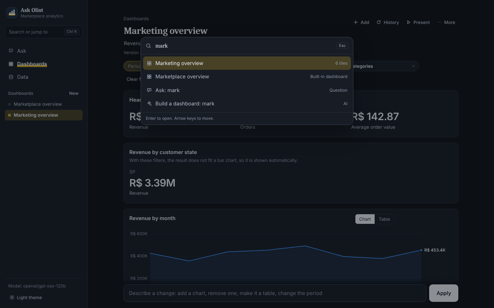

# Ask Olist: dashboards and answers in plain language, on a private database

A self-hosted analytics workspace in the spirit of Metabase, where nobody has to write SQL. Describe a dashboard and watch an AI agent build it chart by chart; change it by asking ("add revenue by state", "make that a table", "only 2018"); filter it, share it, present it. Every query the model writes is read-only and checked before it runs. The data never leaves your server: the model sees the schema and small result previews only.


The demo data is 100,000 orders from Olist, a Brazilian marketplace.

## What makes it more than a demo

- **An agent with real tools, not a chat box.** The dashboard agent edits a draft through `add_tile`, `update_tile`, `move_tile`, `remove_tile`, `add_text`, `set_filters` and `run_sql`. Every tile's SQL is executed and its chart type checked before it is accepted; a refusal goes back to the model, which fixes its query. One request is saved as one version, and Undo restores the one before.
- **Guardrails enforced by the database.** Four independent layers keep model-written SQL read-only and bounded in time and size; the main one is a SQLite authorizer that cannot be talked around.
- **Filters without rewriting SQL.** Period, state and category filters apply to every tile by shadowing the tables with filtered common table expressions of the same name. Values are validated against the data before they reach SQL.
- **Measured, not guessed.** 50 reference questions with gold SQL give an execution-accuracy score, and 14 dashboard requests are checked mechanically (tiles run, charts fit, topics covered, filters set, edits applied). The question harness proves itself with an oracle run that must score 50/50.
- **Resilient to real free-tier models.** Malformed tool calls are repaired, empty or prose replies are retried, and rate-limit waits are shown to the person instead of a frozen spinner.
- **No lock-in, no build step.** Two small HTTP adapters (any OpenAI-compatible API, and Claude); a frontend of plain ES modules and SVG with a strict Content-Security-Policy.



## Features

| Area | What it does |
| --- | --- |
| Build in words | Describe a dashboard and watch it appear tile by tile, with headline numbers, trends, rankings and context text |
| Edit in words | A prompt bar on every dashboard, and "Edit with AI" on each chart to scope a change to it |
| Filters | Period (presets or a custom month range), customer state and product category, applied to every tile; click a bar to filter by it; save as the dashboard's default |
| Share | Filters live in the link; Copy link, present full screen, print or save as PDF, CSV per chart |
| Edit by hand | Rename, describe, add a chart from SQL or a text tile, change a chart's query, type or width, drag to reorder, duplicate a dashboard |
| History | Every change is a version marked "by you" or "by the AI"; restore any of them, Undo after each AI edit |
| Ask | Multi-turn questions with a live step trace, follow-up suggestions, the answer's figures highlighted, and "Add to dashboard" |
| Charts | Headline numbers, ranked bars, single or multi-series lines (a long result is pivoted into one line per category), tables; chosen by tested rules |
| Navigate | Sidebar of dashboards, Ctrl+K / Cmd+K command palette, keyboard-readable charts, light and dark themes |
| Operate | Optional password (`APP_PASSWORD`), rate limits, daily token budget, answer and tile result caches, health check |

| | |
| --- | --- |
|  |  |
|  |  |

## Results

> Not measured on a live model yet. Run `python -m sqlagent eval`, then replace this note with the score from `evals/results/<model>.md`.

The harness itself is verified: `python -m sqlagent eval --oracle` replays the gold SQL through the full pipeline and must score 50/50.

## Quick start

Requires Python 3.11 or newer. The default provider is Groq, whose free plan needs no card.

```bash
git clone https://github.com/ali-chamas/olist-sql-agent.git
cd olist-sql-agent
python -m venv .venv && source .venv/bin/activate
pip install -e ".[dev]"

python scripts/build_db.py --download      # builds data/olist.db (about 65 MB)
python -m sqlagent check-data              # verifies the data against the prompt's assumptions

cp .env.example .env                        # then paste your key into LLM_API_KEY

python -m sqlagent serve                    # http://127.0.0.1:8000
python -m sqlagent ask "Which 5 product categories have the highest revenue?"
```

Run the checks:

```bash
pytest -q                                   # 175 tests, no key and no data needed
node --test tests/js/*.test.mjs             # 22 tests for the frontend helpers
python -m sqlagent eval --oracle            # harness self-test, prints 50/50
python -m sqlagent eval --tpm 8000          # the real evaluation
python -m sqlagent eval-dashboards --tpm 8000   # the dashboard agent's evaluation
```

## Providers

Set `LLM_PROVIDER` in `.env`. Free-tier limits change often; check the provider's page before a long run.

| `LLM_PROVIDER` | API | Default model | Key |
| --- | --- | --- | --- |
| `groq` | OpenAI-compatible | `openai/gpt-oss-120b` | free, no card |
| `gemini` | OpenAI-compatible | `gemini-flash-latest` | free tier |
| `openrouter` | OpenAI-compatible | `openrouter/free` | free models, low daily cap |
| `ollama` | OpenAI-compatible, local | set `LLM_MODEL` | none |
| `anthropic` | Claude Messages API | `claude-haiku-5-5` | paid |
| `custom` | OpenAI-compatible | set `LLM_BASE_URL`, `LLM_MODEL` | yours |

A question takes two to three model calls and roughly 3,000 to 4,000 tokens; building a dashboard takes four to eight calls. On a free tier with a per-minute token limit, the client waits and retries, and the page says so. The eval runner paces itself with `--tpm` and saves each finished case, so a run that hits a daily limit continues the next day with the same command.

## How the Ask agent works

The model gets the full schema in its system prompt, plus business definitions that the column names do not carry (for example, `sales` has one row per order item, so "orders" means `COUNT(DISTINCT order_id)`). It has three tools:

| Tool | Purpose |
| --- | --- |
| `run_sql(sql)` | Try a query and see the first rows or the error. |
| `submit_answer(sql, answer, follow_ups)` | Finish. The SQL is executed again and that result is what the user sees. |
| `cannot_answer(reason)` | Decline when the data cannot answer, instead of inventing a number. |

SQL errors and guardrail refusals go back to the model as tool errors, so it can fix the query. The loop stops after `MAX_STEPS` model calls. For a follow-up question, the last three questions and their SQL are added to the prompt.

## Guardrails

Every query, whether written by the model or typed into the SQL editor, passes four layers in `src/sqlagent/db.py`:

1. **Text check.** One statement, starting with `SELECT` or `WITH`. This gives a clear message; it is not the security boundary.
2. **Read-only connection.** The database is opened with SQLite's `mode=ro`.
3. **Authorizer.** A SQLite authorizer callback allows reads of the five catalogued tables and nothing else: no writes, `PRAGMA`, `ATTACH`, schema tables or extension loading. SQLite enforces this while compiling the statement, so it holds even if the text check is fooled.
4. **Budgets.** A progress handler aborts queries after 5 seconds, and results are capped at 200 rows.

Dashboard filters reach SQL only after validation: a month must match `YYYY-MM`, and a state or category must be a value that exists in the data. Only then is it written into the filtering CTE as a quoted literal.

## Evaluation

`evals/questions.json` holds 50 cases in eight categories:

| Category | Cases | What it checks |
| --- | --- | --- |
| aggregates | 6 | counts, sums, averages |
| filters | 7 | status, date and payment filters |
| grouping | 8 | group by, top N |
| joins | 7 | customers, products, sellers |
| time | 7 | months, quarters, growth |
| order-level | 6 | values repeated on item rows that must be reduced to one row per order |
| customers | 5 | repeat customers, cohorts |
| unanswerable | 4 | questions the data cannot answer, and one request to delete rows |

Scoring is **execution accuracy**: the agent's SQL and the gold SQL are both run, and the results are compared. Any correct query passes, however it is written.

- Row counts must be equal. Row order matters only for "top N" cases.
- Column order and names are ignored, and extra columns are allowed.
- Numbers match within 0.005, so an answer rounded to two decimals matches the unrounded gold value.
- Unanswerable cases pass only when the agent calls `cannot_answer`.

Each run writes `evals/results/<model>.jsonl` and a Markdown report with accuracy by category, tokens, latency and every failing query.

### Evaluating the dashboard agent

A dashboard has no single right answer, so each of the 14 cases in `evals/dashboards.json` states what any good result must have, and the checks are mechanical: the run finishes; the tile count is in range; every chart tile's SQL runs as saved and returns rows; the chart types the request implies are present (a trend needs a line); each required topic appears in a title or the SQL; expected filters are set; and for edits, the right tiles were kept or removed. Cases cover building from scratch, setting filters, editing an existing dashboard (including a request scoped to one tile), and refusing what the data cannot do or what would write to it.

```bash
python -m sqlagent eval-dashboards --tpm 8000   # writes evals/results/dashboards-<model>.md
```

## The dashboard agent

The model gets the schema, the business rules, and the current dashboard as JSON (tiles with their id, title, chart type, width and SQL, plus the filters). It changes a draft through tools:

| Tool | What it does |
| --- | --- |
| `add_tile(title, sql, chart, size, note, position)` | Runs the SQL through the guardrails, checks the chart type fits the result, then adds the tile |
| `update_tile(tile_id, ...)` | The same checks for a changed query or chart type |
| `move_tile`, `remove_tile`, `update_dashboard` | Layout, title and description |
| `add_text(title, text)` | A heading and short context, no query |
| `set_filters(date_from, date_to, state, category)` | Limits the whole dashboard instead of editing every query |
| `run_sql(sql)` | Look at the data before deciding |
| `finish(summary)`, `cannot_do(reason)` | End the run |

Every tool result ends with the current tile list, so the model works from the real state. Each successful change is streamed to the page with the rows the agent just checked, which is how the dashboard draws itself while the model works. The draft is saved once, as one version, with a summary built from the changes.

## Deploying a free public demo

The repository includes a `Dockerfile` and a Render blueprint (`render.yaml`). The image builds the database at build time, so the container needs no volume.

1. Push the repository to GitHub.
2. On [Render](https://render.com), choose New, then Blueprint, and pick the repository.
3. Enter your `LLM_API_KEY` when asked. Leave the plan on Free.

What to expect on a free instance: it sleeps after about 15 minutes without traffic, and the first request after that takes around a minute. Opening dashboards works even when the day's model quota is spent, because it never calls the model.

Saved dashboards live in `APP_DB_PATH` (default `data/app.db`), a separate writable SQLite file. Render's free plan has no persistent disk, so dashboards made there are lost on each redeploy or restart; attach a disk on a paid plan, or run it locally, to keep them.

Settings that protect the key, all in `.env.example`: `DAILY_TOKEN_BUDGET`, `ASK_PER_MINUTE`, `QUERY_PER_MINUTE`, `CACHE_TTL_S`, `TRUST_PROXY`. Set `APP_PASSWORD` to require a password (HTTP Basic) for every page and API call; the health check stays open for the platform.

## Project layout

```
src/sqlagent/
  catalog.py        schema and data notes: one definition feeds the DDL, the prompt and the guardrails
  db.py             read-only executor with the four guardrail layers
  llm.py            neutral message types, HTTP retries, OpenAI-compatible and Claude adapters
  prompts.py        system prompt and tool definitions
  agent.py          the tool loop, conversation context, step events
  presentation.py   rules that pick a chart form from a result
  dashboards.py     the curated overview and its year filter
  workspace.py      saved dashboards: tiles, text tiles, filters, versions, optimistic concurrency
  builder.py        the dashboard agent, its editing tools and live previews
  filters.py        dashboard filters as table-shadowing CTEs, validated against the data
  workspace_api.py  dashboard routes, the streamed AI edit, the tile result cache
  limits.py         rate limiter, answer cache, daily token budget
  dataquality.py    checks that the data matches what the prompt assumes
  evaluation.py     result comparison, scoring, pacing, report
  dashboard_eval.py checks and report for the dashboard agent
  app.py            Starlette API, server-sent events, security headers
  static/           the web app: plain ES modules and SVG, no build step
    js/workspace.js   dashboards: list, live build, editor, drag and drop, present mode
    js/filterbar.js   period, state and category filters
    js/palette.js     the Ctrl+K command palette
    js/charts.js      stat tiles, bars and lines drawn as SVG, with tooltips and keyboard reading
evals/questions.json   50 reference questions with gold SQL
evals/dashboards.json  14 dashboard requests with the checks a good result must pass
scripts/build_db.py    workbook to SQLite
tests/                 175 Python tests and 22 JavaScript tests
```

Design choices and trade-offs are in [DESIGN.md](DESIGN.md).

## Limitations

- One fixed schema of five tables. A larger schema would not fit in the prompt and needs retrieval.
- SQLite, single process. The cache, rate limiter and token budget live in memory and reset on restart.
- One shared workspace, no user accounts: everyone with the password can see and edit every dashboard. History records whether a change was made by a person or the AI, not which person.
- Filters know three dimensions of this schema (period, customer state, product category). Another database needs its own filter definitions.
- The reference questions are in English and were written by the same person as the prompt, so the score is optimistic for questions phrased very differently.
- Execution accuracy cannot tell a correct query from one that returns the right rows by coincidence.

## Data

The database is built from the star schema in [olist-powerbi-analysis](https://github.com/ali-chamas/olist-powerbi-analysis), which models the [Olist Brazilian E-commerce public dataset](https://www.kaggle.com/datasets/olistbr/brazilian-ecommerce). The data is not included in this repository; see the Kaggle page for its licence. Olist is not a client.

Code: MIT licence.
