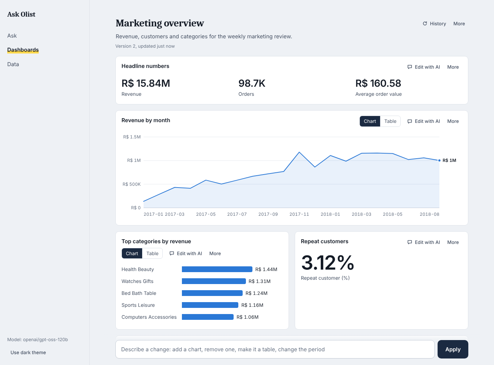
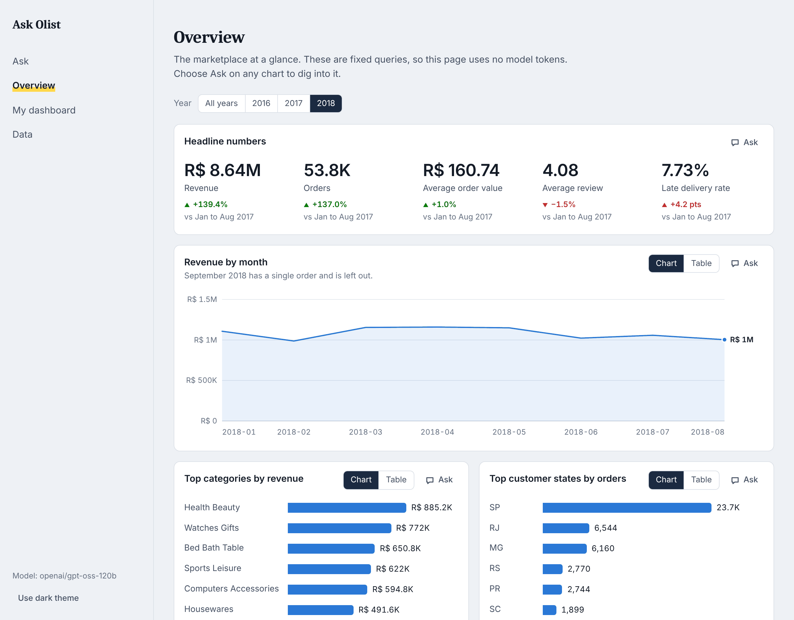
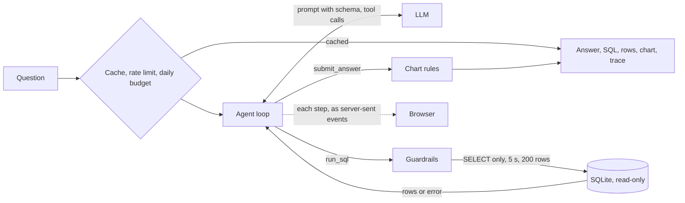

# Ask Olist: dashboards and answers from plain language, on a private database

Ask a business question in plain language about 100,000 e-commerce orders, or describe a dashboard and have it built. An LLM agent writes SQL, runs it on a read-only database, corrects its own mistakes, and returns the answer with a chart and every step it took. Saved dashboards are edited the same way: "add revenue by state as a table", "make the trend start in 2017", "remove the payment chart". Nobody on the team needs to know SQL.





What makes it more than a demo:

- **Guardrails.** Model-written SQL is untrusted input. Four independent layers keep it read-only, bounded in time and bounded in size.
- **Evaluation.** 50 reference questions with hand-written gold SQL give an execution-accuracy score, so a prompt or model change is measured, not guessed.
- **Visible work.** The agent's steps stream to the page as they happen, including the queries that failed and how they were fixed.
- **Dashboards the AI can build and edit.** The dashboard agent has tools to add, change, move and remove tiles. Every tile's SQL passes the same guardrails, each AI request is saved as one version, and Undo restores the one before.
- **Charts without extra model calls.** The chart form is chosen by tested rules on the server. Opening a dashboard reruns its saved SQL; the model is only called to change it.
- **Built to run on a free tier.** Answer cache, per-client rate limits and a daily token budget keep a public demo inside a free API key.
- **No lock-in.** Two small adapters over plain HTTPS: any OpenAI-compatible API (Groq, Gemini, OpenRouter, Ollama) and Claude.



## Results

> Not measured on a live model yet. Run `make eval`, then replace this note with the score from `evals/results/<model>.md`.

The harness itself is verified: `make eval-selftest` replays the gold SQL through the full pipeline and must score 50/50.

## Features

| Area | What it does |
| --- | --- |
| Ask | Multi-turn questions ("and for 2018?"), live step trace with a timer, Stop, follow-up suggestions, answer cache |
| Answers | The answer first, with its figures highlighted; then the chart; "How this was answered" one click away |
| Figures | Stat tiles, ranked bars or a line chart chosen from the result's shape; table view and CSV for every result |
| SQL | Edit the final query and rerun it through the same guardrails; copy it in one click |
| Overview | Curated dashboard with a year filter and same-period comparisons (2018 vs Jan to Aug 2017); zero model tokens |
| Build a dashboard | Describe it ("Marketing overview: revenue trend, top categories, repeat customers") and watch the tiles being added |
| Edit with AI | A prompt bar on every dashboard, and "Edit with AI" on each tile to scope a change to one chart |
| Edit by hand | Rename, describe, change a tile's SQL, chart type or width, reorder, remove; no model call |
| History | Every change is a version with who made it (you or the AI); restore any version, Undo after each AI edit |
| Add to dashboard | Save any answer from Ask to an existing or new dashboard |
| Dashboards to Ask | Choose "Ask about this" on any tile to start a conversation with that chart as context |
| Data | Schema browser with the descriptions the model sees, and known data quirks |
| Errors | Plain-language explanations (rejected key, rate limit, no connection) with Try again; raw detail kept behind a toggle |
| Keyboard | Press / to ask from anywhere, the up arrow to recall the last question, arrow keys to read line charts |
| Operations | Daily token budget with a quota meter, rate limits, strict Content-Security-Policy |

## Quick start

Requires Python 3.11 or newer. The default provider is Groq, whose free plan needs no card.

```bash
git clone https://github.com/ali-chamas/olist-sql-agent.git
cd olist-sql-agent
python -m venv .venv && source .venv/bin/activate
pip install -e ".[dev]"

python scripts/build_db.py --download      # builds data/olist.db (about 65 MB)
python -m sqlagent check-data              # verifies the data against the prompt's assumptions

cp .env.example .env                        # then paste your key into LLM_API_KEY

python -m sqlagent serve                    # http://127.0.0.1:8000
python -m sqlagent ask "Which 5 product categories have the highest revenue?"
```

Run the checks:

```bash
pytest -q                                   # 119 tests, no key and no data needed
node --test tests/js/*.test.mjs             # 14 tests for the frontend helpers
python -m sqlagent eval --oracle            # harness self-test, prints 50/50
python -m sqlagent eval --tpm 8000          # the real evaluation
```

## Providers

Set `LLM_PROVIDER` in `.env`. Free-tier limits change often; check the provider's page before a long run.

| `LLM_PROVIDER` | API | Default model | Key |
| --- | --- | --- | --- |
| `groq` | OpenAI-compatible | `openai/gpt-oss-120b` | free, no card |
| `gemini` | OpenAI-compatible | `gemini-flash-latest` | free tier |
| `openrouter` | OpenAI-compatible | `openrouter/free` | free models, low daily cap |
| `ollama` | OpenAI-compatible, local | set `LLM_MODEL` | none |
| `anthropic` | Claude Messages API | `claude-haiku-5-5` | paid |
| `custom` | OpenAI-compatible | set `LLM_BASE_URL`, `LLM_MODEL` | yours |

A question takes two to three model calls and roughly 3,000 to 4,000 tokens. The eval runner paces itself with `--tpm` and saves each finished case, so a run that hits a daily limit continues the next day with the same command.

## How the agent works

The model gets the full schema in its system prompt, plus business definitions that the column names do not carry (for example, `sales` has one row per order item, so "orders" means `COUNT(DISTINCT order_id)`). It has three tools:

| Tool | Purpose |
| --- | --- |
| `run_sql(sql)` | Try a query and see the first rows or the error. |
| `submit_answer(sql, answer, follow_ups)` | Finish. The SQL is executed again and that result is what the user sees. |
| `cannot_answer(reason)` | Decline when the data cannot answer, instead of inventing a number. |

SQL errors and guardrail refusals go back to the model as tool errors, so it can fix the query. The loop stops after `MAX_STEPS` model calls. For a follow-up question, the last three questions and their SQL are added to the prompt.

## Guardrails

Every query, whether written by the model or typed into the SQL editor, passes four layers in `src/sqlagent/db.py`:

1. **Text check.** One statement, starting with `SELECT` or `WITH`. This gives a clear message; it is not the security boundary.
2. **Read-only connection.** The database is opened with SQLite's `mode=ro`.
3. **Authorizer.** A SQLite authorizer callback allows reads of the five catalogued tables and nothing else: no writes, `PRAGMA`, `ATTACH`, schema tables or extension loading. SQLite enforces this while compiling the statement, so it holds even if the text check is fooled.
4. **Budgets.** A progress handler aborts queries after 5 seconds, and results are capped at 200 rows.

The dashboard's year filter never reaches SQL as text: it is checked against a whitelist and mapped to a constant clause.

## Evaluation

`evals/questions.json` holds 50 cases in eight categories:

| Category | Cases | What it checks |
| --- | --- | --- |
| aggregates | 6 | counts, sums, averages |
| filters | 7 | status, date and payment filters |
| grouping | 8 | group by, top N |
| joins | 7 | customers, products, sellers |
| time | 7 | months, quarters, growth |
| order-level | 6 | values repeated on item rows that must be reduced to one row per order |
| customers | 5 | repeat customers, cohorts |
| unanswerable | 4 | questions the data cannot answer, and one request to delete rows |

Scoring is **execution accuracy**: the agent's SQL and the gold SQL are both run, and the results are compared. Any correct query passes, however it is written.

- Row counts must be equal. Row order matters only for "top N" cases.
- Column order and names are ignored, and extra columns are allowed.
- Numbers match within 0.005, so an answer rounded to two decimals matches the unrounded gold value.
- Unanswerable cases pass only when the agent calls `cannot_answer`.

Each run writes `evals/results/<model>.jsonl` and a Markdown report with accuracy by category, tokens, latency and every failing query.

## Deploying a free public demo

The repository includes a `Dockerfile` and a Render blueprint (`render.yaml`). The image builds the database at build time, so the container needs no volume.

1. Push the repository to GitHub.
2. On [Render](https://render.com), choose New, then Blueprint, and pick the repository.
3. Enter your `LLM_API_KEY` when asked. Leave the plan on Free.

What to expect on a free instance: it sleeps after about 15 minutes without traffic, and the first request after that takes around a minute. Opening dashboards works even when the day's model quota is spent, because it never calls the model.

Saved dashboards live in `APP_DB_PATH` (default `data/app.db`), a separate writable SQLite file. Render's free plan has no persistent disk, so dashboards made there are lost on each redeploy or restart; attach a disk on a paid plan, or run it locally, to keep them.

Settings that protect the key, all in `.env.example`: `DAILY_TOKEN_BUDGET`, `ASK_PER_MINUTE`, `QUERY_PER_MINUTE`, `CACHE_TTL_S`, `TRUST_PROXY`.

## Project layout

```
src/sqlagent/
  catalog.py        schema and data notes: one definition feeds the DDL, the prompt and the guardrails
  db.py             read-only executor with the four guardrail layers
  llm.py            neutral message types, HTTP retries, OpenAI-compatible and Claude adapters
  prompts.py        system prompt and tool definitions
  agent.py          the tool loop, conversation context, step events
  presentation.py   rules that pick a chart form from a result
  dashboards.py     the curated overview and its year filter
  workspace.py      saved dashboards: tiles, versions, history, optimistic concurrency
  builder.py        the dashboard agent and its editing tools
  workspace_api.py  dashboard routes, including the streamed AI edit
  limits.py         rate limiter, answer cache, daily token budget
  dataquality.py    checks that the data matches what the prompt assumes
  evaluation.py     result comparison, scoring, pacing, report
  app.py            Starlette API, server-sent events, security headers
  static/           the web app: plain ES modules and SVG, no build step
evals/questions.json   50 reference questions with gold SQL
scripts/build_db.py    workbook to SQLite
tests/                 143 Python tests and 18 JavaScript tests
```

Design choices and trade-offs are in [DESIGN.md](DESIGN.md).

## Limitations

- One fixed schema of five tables. A larger schema would not fit in the prompt and needs retrieval.
- SQLite, single process. The cache, rate limiter and token budget live in memory and reset on restart.
- No accounts: everyone who can open the app can see and edit every dashboard. Put it behind your own sign-in (a reverse proxy or VPN) before sharing it outside the team.
- The reference questions are in English and were written by the same person as the prompt, so the score is optimistic for questions phrased very differently.
- Execution accuracy cannot tell a correct query from one that returns the right rows by coincidence.

## Data

The database is built from the star schema in [olist-powerbi-analysis](https://github.com/ali-chamas/olist-powerbi-analysis), which models the [Olist Brazilian E-commerce public dataset](https://www.kaggle.com/datasets/olistbr/brazilian-ecommerce). The data is not included in this repository; see the Kaggle page for its licence. Olist is not a client.

Code: MIT licence.
