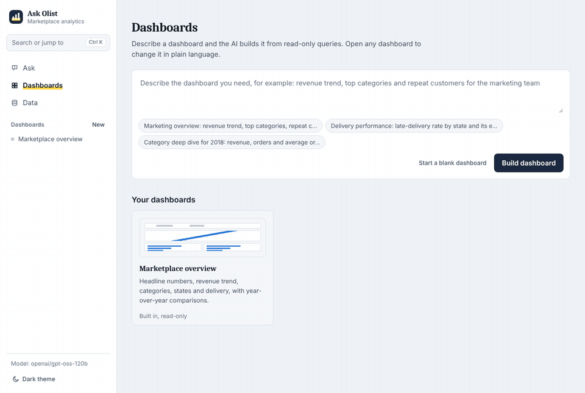
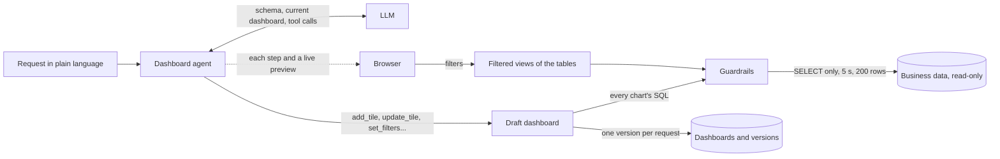

# Ask Olist

**Dashboards you describe instead of build.** Ask Olist is a self-hosted analytics workspace where a team creates and changes business dashboards in plain language. An AI agent writes the SQL, checks every chart against the real data, and builds the dashboard in front of you, while the database stays private and read-only.



## Why it exists

In most companies, a marketing or operations team that wants a new chart files a request and waits for an analyst. BI tools such as Metabase, Looker or Power BI shorten that wait, but they still expect someone who knows the schema: which table holds orders, why revenue must be summed per order rather than per item, how a "repeat customer" is defined. General-purpose AI chat assistants can write SQL, but their answers vanish with the conversation, nothing guarantees their queries only read, and using them usually means sending company data to a third party.

Ask Olist sits between the two. The team describes what it wants to see ("a weekly marketing overview: revenue trend, top categories, repeat customers"), and the agent turns that into a dashboard that is saved, versioned and shared like any BI dashboard. Changing it is another sentence ("only 2018", "add revenue by state", "make that a table"), or a few clicks for anyone who prefers to edit by hand. The model sees the schema and small previews of query results, never the database itself, and with a local model through Ollama nothing leaves your machine at all. Every query runs on your own server, through guardrails that the database itself enforces.

It ships with a real dataset to explore: 100,000 orders from Olist, a Brazilian online marketplace, with customers, products, sellers, payments, deliveries and reviews.

## What you can do

- **Build a dashboard from a sentence.** The agent plans the tiles, writes and runs each query, picks a chart that fits the result, and adds headings where context helps. You watch each chart appear as it is added.
- **Change it by asking.** Use the prompt bar for the whole dashboard, or "Edit with AI" on a single chart: add, remove, reorder, resize, switch a chart to a table, or limit everything to a period, a state or a category.
- **Explore with filters.** Period, customer state and product category apply to every chart at once. Click a bar to filter by it; save the current filters as the dashboard's default.
- **Ask one-off questions.** A conversation view answers questions with the figures highlighted, shows every step the agent took and the SQL it ran, suggests follow-ups, and saves any answer to a dashboard.
- **Share and present.** A filtered view is a link. Present full screen, print or save as PDF, download any chart's data as CSV.
- **Trust what you see.** Every chart keeps its SQL, which you can read and edit. Every change is a version marked as made by a person or by the AI, and any version can be restored; each AI edit can be undone in one click.

## Features

| Area | What it does |
| --- | --- |
| Build in words | Describe a dashboard and watch it appear tile by tile: headline numbers, trends, rankings and short context text |
| Edit in words | A prompt bar on every dashboard, with suggestions, and "Edit with AI" on each chart to scope a change to it |
| Filters | Period (presets or any month range), customer state and product category, applied to every chart; click a bar to filter by it |
| Share | Filters live in the link; copy link, present full screen, print or save as PDF, CSV per chart |
| Edit by hand | Rename and describe; add a chart from SQL or a text block; change a chart's query, type or width; drag to reorder; duplicate a chart or a dashboard |
| History | Every change is a version marked "by you" or "by the AI"; restore any version, undo after each AI edit |
| Ask | Multi-turn questions with a live step trace, follow-up suggestions, highlighted figures and "Add to dashboard" |
| Charts | Headline numbers, ranked bars, single or multi-series lines (a long result becomes one line per category) and tables, chosen by tested rules |
| Navigate | Sidebar of dashboards, Ctrl+K or Cmd+K command palette, charts readable from the keyboard, light and dark themes |
| Operate | Optional password, rate limits, a daily token budget, result caches and a health check |

| | |
| --- | --- |
|  |  |
|  |  |

## How it works



The agent does not write dashboards directly. It works on a draft through a small set of tools (add, update, move and remove a chart, add text, set filters, run a query to look at the data, finish or decline). Every chart it adds is executed through the guardrails and checked against its chart type before it is accepted; if a query fails or does not fit, the error goes back to the model, which corrects it. Each change is streamed to the page with its result, which is how the dashboard draws itself while the model works. The finished draft is saved once, as one version, so a single click undoes the whole request.

Filters work on any chart without rewriting its SQL: the tables are replaced, for that query only, by filtered views of the same name. The design notes in [DESIGN.md](DESIGN.md) explain this and the other decisions in detail.

The model provider is a setting. Two small HTTP adapters cover any OpenAI-compatible API (Groq, Gemini, OpenRouter, Ollama and others) and Claude. The frontend is plain ES modules and SVG with no build step and a strict Content-Security-Policy.

## Accuracy

> Not yet measured on a live model. Run `python -m sqlagent eval` and `python -m sqlagent eval-dashboards`, then replace this note with the scores from `evals/results/`.

The question agent is scored on 50 reference questions with known correct SQL, and the dashboard agent on 14 dashboard requests with mechanical checks; both are described under [Evaluation](#evaluation). The scoring harness verifies itself: `python -m sqlagent eval --oracle` replays the reference SQL through the full pipeline and must score 50/50.

## Quick start

You need Python 3.11 or newer and an API key for a model provider. The default is Groq, whose free plan needs no card.

```bash
git clone https://github.com/ali-chamas/olist-sql-agent.git
cd olist-sql-agent
python -m venv .venv && source .venv/bin/activate
pip install -e ".[dev]"

python scripts/build_db.py --download      # builds data/olist.db (about 65 MB)
python -m sqlagent check-data              # verifies the data against the prompt's assumptions

cp .env.example .env                        # then paste your key into LLM_API_KEY

python -m sqlagent serve                    # http://127.0.0.1:8000
python -m sqlagent ask "Which 5 product categories have the highest revenue?"
```

Tests and evaluations:

```bash
pytest -q                                   # 175 tests, no key and no data needed
node --test tests/js/*.test.mjs             # 22 tests for the frontend helpers
python -m sqlagent eval --oracle            # harness self-test, prints 50/50
python -m sqlagent eval --tpm 8000          # the real evaluation
python -m sqlagent eval-dashboards --tpm 8000   # the dashboard agent's evaluation
```

## Providers

Set `LLM_PROVIDER` in `.env`. Free-tier limits change often; check the provider's page before a long run.

| `LLM_PROVIDER` | API | Default model | Key |
| --- | --- | --- | --- |
| `groq` | OpenAI-compatible | `openai/gpt-oss-120b` | free, no card |
| `gemini` | OpenAI-compatible | `gemini-flash-latest` | free tier |
| `openrouter` | OpenAI-compatible | `openrouter/free` | free models, low daily cap |
| `ollama` | OpenAI-compatible, local | set `LLM_MODEL` | none |
| `anthropic` | Claude Messages API | `claude-haiku-5-5` | paid |
| `custom` | OpenAI-compatible | set `LLM_BASE_URL`, `LLM_MODEL` | yours |

A question takes two to three model calls and roughly 3,000 to 4,000 tokens; building a dashboard takes four to eight calls. On a free tier with a per-minute token limit, the client waits and retries, and the page says so. The eval runner paces itself with `--tpm` and saves each finished case, so a run that hits a daily limit continues the next day with the same command.

## The question agent

The model gets the full schema in its system prompt, plus business definitions that the column names do not carry (for example, `sales` has one row per order item, so "orders" means `COUNT(DISTINCT order_id)`). It has three tools:

| Tool | Purpose |
| --- | --- |
| `run_sql(sql)` | Try a query and see the first rows or the error. |
| `submit_answer(sql, answer, follow_ups)` | Finish. The SQL is executed again and that result is what the user sees. |
| `cannot_answer(reason)` | Decline when the data cannot answer, instead of inventing a number. |

SQL errors and guardrail refusals go back to the model as tool errors, so it can fix the query. The loop stops after `MAX_STEPS` model calls. For a follow-up question, the last three questions and their SQL are added to the prompt.

## The dashboard agent

The model gets the schema, the business rules and the current dashboard as JSON (each chart's id, title, type, width and SQL, plus the filters). It changes a draft through these tools:

| Tool | What it does |
| --- | --- |
| `add_tile(title, sql, chart, size, note, position)` | Runs the SQL through the guardrails, checks the chart type fits the result, then adds the tile |
| `update_tile(tile_id, ...)` | The same checks for a changed query or chart type |
| `move_tile`, `remove_tile`, `update_dashboard` | Layout, title and description |
| `add_text(title, text)` | A heading and short context, no query |
| `set_filters(date_from, date_to, state, category)` | Limits the whole dashboard instead of editing every query |
| `run_sql(sql)` | Look at the data before deciding |
| `finish(summary)`, `cannot_do(reason)` | End the run |

Every tool result ends with the current tile list, so the model works from the real state. Each successful change is streamed to the page with the rows the agent just checked, which is how the dashboard draws itself while the model works. The draft is saved once, as one version, with a summary built from the changes.

## Guardrails

A language model can be persuaded to write anything, so safety cannot depend on the prompt. Every query, whether written by the model or typed by a person, passes four layers in `src/sqlagent/db.py`:

1. **Text check.** One statement, starting with `SELECT` or `WITH`. This gives a clear message; it is not the security boundary.
2. **Read-only connection.** The database is opened with SQLite's `mode=ro`.
3. **Authorizer.** A SQLite authorizer callback allows reads of the five catalogued tables and nothing else: no writes, `PRAGMA`, `ATTACH`, schema tables or extension loading. SQLite enforces this while compiling the statement, so it holds even if the text check is fooled.
4. **Budgets.** A progress handler aborts queries after 5 seconds, and results are capped at 200 rows.

Dashboard filters reach SQL only after validation: a month must match `YYYY-MM`, and a state or category must be a value that exists in the data. Only then is it written into the filtering CTE as a quoted literal.

## Evaluation

`evals/questions.json` holds 50 cases in eight categories:

| Category | Cases | What it checks |
| --- | --- | --- |
| aggregates | 6 | counts, sums, averages |
| filters | 7 | status, date and payment filters |
| grouping | 8 | group by, top N |
| joins | 7 | customers, products, sellers |
| time | 7 | months, quarters, growth |
| order-level | 6 | values repeated on item rows that must be reduced to one row per order |
| customers | 5 | repeat customers, cohorts |
| unanswerable | 4 | questions the data cannot answer, and one request to delete rows |

Scoring is **execution accuracy**: the agent's SQL and the gold SQL are both run, and the results are compared. Any correct query passes, however it is written.

- Row counts must be equal. Row order matters only for "top N" cases.
- Column order and names are ignored, and extra columns are allowed.
- Numbers match within 0.005, so an answer rounded to two decimals matches the unrounded gold value.
- Unanswerable cases pass only when the agent calls `cannot_answer`.

Each run writes `evals/results/<model>.jsonl` and a Markdown report with accuracy by category, tokens, latency and every failing query.

### Evaluating the dashboard agent

A dashboard has no single right answer, so each of the 14 cases in `evals/dashboards.json` states what any good result must have, and the checks are mechanical: the run finishes; the tile count is in range; every chart tile's SQL runs as saved and returns rows; the chart types the request implies are present (a trend needs a line); each required topic appears in a title or the SQL; expected filters are set; and for edits, the right tiles were kept or removed. Cases cover building from scratch, setting filters, editing an existing dashboard (including a request scoped to one tile), and refusing what the data cannot do or what would write to it.

```bash
python -m sqlagent eval-dashboards --tpm 8000   # writes evals/results/dashboards-<model>.md
```

## Deploying

The repository includes a `Dockerfile` and a Render blueprint (`render.yaml`). The image builds the database at build time, so the container needs no volume, and it reports its health on `/api/health`.

To run it on Render's free plan:

1. Fork or push the repository to GitHub.
2. On [Render](https://render.com), choose New, then Blueprint, and pick the repository.
3. Enter your `LLM_API_KEY` when asked, and optionally an `APP_PASSWORD`.

A free instance sleeps after about 15 minutes without traffic, and the first request after that takes around a minute. Opening and filtering dashboards keeps working when the day's model quota is spent, because it never calls the model.

Saved dashboards live in `APP_DB_PATH` (default `data/app.db`), a separate writable SQLite file. Render's free plan has no persistent disk, so dashboards made there are lost on each redeploy or restart; attach a disk on a paid plan, or run it locally, to keep them.

Settings that protect the key and the data, all documented in `.env.example`: `APP_PASSWORD` requires a password for every page and API call (the health check stays open for the platform); `DAILY_TOKEN_BUDGET`, `ASK_PER_MINUTE` and `QUERY_PER_MINUTE` cap usage; `CACHE_TTL_S` sets how long answers are reused; `TRUST_PROXY` makes rate limits use the client address behind a proxy.

## Project layout

```
src/sqlagent/
  catalog.py        schema and data notes: one definition feeds the DDL, the prompt and the guardrails
  db.py             read-only executor with the four guardrail layers
  llm.py            neutral message types, HTTP retries, OpenAI-compatible and Claude adapters
  prompts.py        system prompt and tool definitions
  agent.py          the tool loop, conversation context, step events
  presentation.py   rules that pick a chart form from a result
  dashboards.py     the curated overview and its year filter
  workspace.py      saved dashboards: tiles, text tiles, filters, versions, optimistic concurrency
  builder.py        the dashboard agent, its editing tools and live previews
  filters.py        dashboard filters as table-shadowing CTEs, validated against the data
  workspace_api.py  dashboard routes, the streamed AI edit, the tile result cache
  limits.py         rate limiter, answer cache, daily token budget
  dataquality.py    checks that the data matches what the prompt assumes
  evaluation.py     result comparison, scoring, pacing, report
  dashboard_eval.py checks and report for the dashboard agent
  app.py            Starlette API, server-sent events, security headers
  static/           the web app: plain ES modules and SVG, no build step
    js/workspace.js   dashboards: list, live build, editor, drag and drop, present mode
    js/filterbar.js   period, state and category filters
    js/palette.js     the Ctrl+K command palette
    js/charts.js      stat tiles, bars and lines drawn as SVG, with tooltips and keyboard reading
evals/questions.json   50 reference questions with gold SQL
evals/dashboards.json  14 dashboard requests with the checks a good result must pass
scripts/build_db.py    workbook to SQLite
tests/                 175 Python tests and 22 JavaScript tests
```

Design choices and trade-offs are in [DESIGN.md](DESIGN.md).

## Current limitations

- One fixed schema of five tables. A larger schema would not fit in the prompt and needs retrieval.
- SQLite, single process. The cache, rate limiter and token budget live in memory and reset on restart.
- One shared workspace, no user accounts: everyone with the password can see and edit every dashboard. History records whether a change was made by a person or the AI, not which person.
- Filters know three dimensions of this schema (period, customer state, product category). Another database needs its own filter definitions.
- The reference questions are in English and were written by the same person as the prompt, so a score will be optimistic for questions phrased very differently.
- Execution accuracy cannot tell a correct query from one that returns the right rows by coincidence.

## Roadmap

- Connect a team's own PostgreSQL database through a read-only role, with its schema, business rules and filters described in a configuration file instead of code.
- User accounts, so history records who made each change and dashboards can be private or shared.
- Scheduled delivery of a dashboard by email, and alerts when a number crosses a threshold.
- Published scores for several models on both evaluations.

## Data

The database is built from the star schema in [olist-powerbi-analysis](https://github.com/ali-chamas/olist-powerbi-analysis), which models the [Olist Brazilian E-commerce public dataset](https://www.kaggle.com/datasets/olistbr/brazilian-ecommerce). The data is not included in this repository; see the Kaggle page for its licence. Olist is not a client.

Code: MIT licence.
